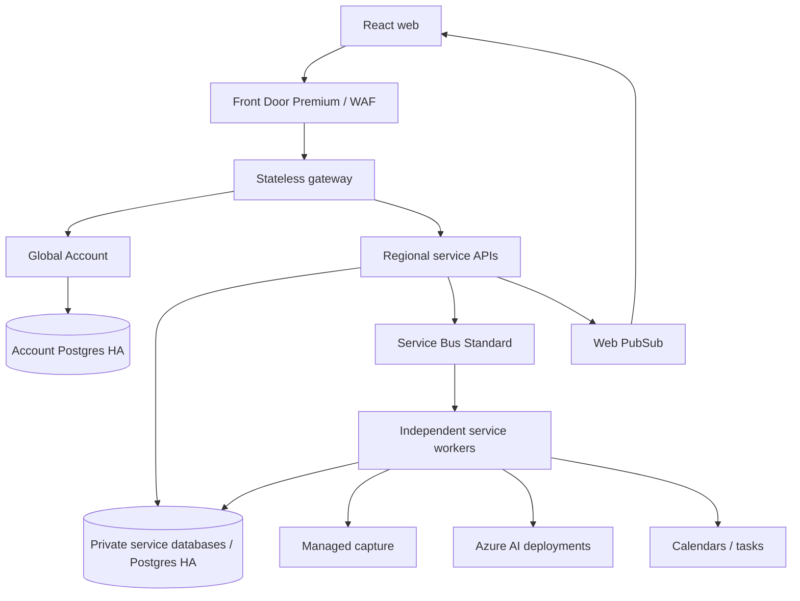

# Microservices architecture

Status: approved target; see status.md for implementation evidence.

## Ownership

| Service | Authoritative records | External dependencies |
|---|---|---|
| account (global) | Identity mappings, membership, entitlements, usage reservations/ledger, cell directory | WorkOS |
| workspace | Customers, contacts, projects, meetings, notes, confirmed assignments, sharing intent, accepted decisions/commitments, agendas, deletion saga | Account/Authz |
| ingest | Capture requests/attempts, dispatch uncertainty, stop state, transcript revisions/segments, labels, coverage | Recall |
| integration | OAuth tokens, calendar occurrences/cursors, connector config, external references and execution attempts | Google/Microsoft/task APIs |
| intelligence | Generated proposals/summaries, indexed evidence, vectors, private chat threads/answers and agenda drafts | Azure models |
| workflow | Exact-payload approvals, durable operations, reconciliation state | Workspace/Integration |
| notification | Preferences, notification jobs and delivery attempts | Email provider |
| reporting | Export jobs and reporting projections | Authorized APIs/Blob |
| authz | OpenFGA relationship tuples/model | Membership and sharing events |
| live (later) | In-meeting suggestions and dedicated quota | Final segments/models |

Workflow is delivered with approved actions. Live and a visual Flow builder are later releases.
No empty deployable service counts as a delivered feature.

## Deployment

APIs/workers run in Container Apps; scheduled maintenance uses Container Apps Jobs.
Global account has a distinct physical PostgreSQL server. Each cell has a shared physical
server with separate logical databases and roles per service. One cell initially; directory
resolution is server-controlled, never a client-supplied destination URL.

Use Front Door Premium before external customers for private origins and WAF. Managed identities
access Azure dependencies. Secrets use Key Vault; text imports/exports use Blob. Service Bus
Standard does not receive a private endpoint (that capability needs Premium).

## Database boundaries

Each service owns its Drizzle schema, migrations and database. Runtime roles are non-owner,
non-superuser and non-BYPASSRLS; migration roles are separate. Tenant tables include workspace_id
and FORCE ROW LEVEL SECURITY. Tenant context is transaction-local, never session-global on a pool.
No cross-service SQL joins, foreign keys, shared ORM models or table access.

Transactions are local to the owner service. Cross-service consistency uses durable workflows,
authorized read APIs and event-built projections. Explicit deletion/revocation barriers override
stale positive projections. No eventual-consistency window may expose revoked content.

## Service communication

Versioned REST for authorized reads/commands; Service Bus for async events. Persist domain changes
and the outbox in one transaction. Publish after commit, accept at-least-once delivery, deduplicate
through consumer inboxes. Consumer effects and inbox completion share a transaction.
Order transcript/meeting aggregate changes using versions and sessions where required.

Envelopes contain IDs, schema/aggregate versions, trace ID, timestamp, actor and source references.
They do not contain arbitrary transcript, credentials or meeting URLs. Fetch sensitive content
through a scoped owning-service API. Broker completion follows durable commit.

Retry transient transport errors with bounded backoff and jitter. Ambiguous externally committed
operations enter reconciliation; do not blindly repeat them. Dead-letter jobs retain safe reason
codes and operator replay history. Leases use fencing to reject stale worker writes.

## Runtime separation and latency

Separate deployments/queues for capture dispatch, text ingress, calendar sync, interactive chat,
summary/indexing, action execution and reporting. A long model call never blocks capture or calendars.
Keep critical ingress warm; bound pool sizes across all replicas. Apply fair workspace scheduling,
admission concurrency limits, model quotas and usage reservations before billable side effects.

Account owns usage reservations. Ingest records the reservation reference and its own capture/outbox
transaction. Failures between these steps are reconciled; reservation expiry must not reclaim an
active provider attempt without checking its durable owner. Billing consumption events deduplicate.

Dashboard projections avoid synchronous fan-out on every read. Evidence reads are batched and
permission-filtered. Web PubSub grants are short-lived and subscribe-only; clients refetch authorized
objects on events. Reconnect resynchronizes from current versions.

Start with pgvector plus PostgreSQL FTS. Add Redis with Live; add AI Search or new cells only after
measuring workload and retrieval limits. Qualification starts at five concurrent meetings;
the archive's larger capacity aspirations are not established performance.

## Repository rules

apps/web: React/Vite/TanStack Router. services/*: Fastify/TypeScript/Zod/Drizzle.
packages/*: contracts and shared technical utilities; no service persistence/business rules.
infra/azure: Bicep; infra/local: local dependencies; tests: contracts/evaluation/resilience/E2E.

Within each service: domain → framework-free rules; application → use cases/ports;
http and consumers → validated adapters; infrastructure → persistence/providers/messaging.
Dependencies point inward. Service code cannot import another service implementation.
Gateway routes/authenticates/composes bounded responses and owns no workflow or business database.
